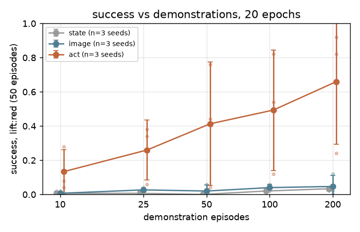

# so-arm100-il

Imitation learning on the [SO-ARM100 MuJoCo bench](https://github.com/AungKaung1928/so-arm100-sim):
behaviour cloning from scripted demonstrations, DAgger with the same scripted
expert as the labelling oracle, and an ACT-style chunked policy. Every policy
is measured with the bench's protocol on nominal and held-out physics, and
the main experiment is a dataset-size curve: how many demonstrations each
model needs. CPU only.

**Status: measured.** Recording, training, the held-out physics table, DAgger
and the scaling curve for all three models are filled from their JSONs;
none is typed by hand. Headline: from the same 200 scripted demonstrations
an ACT-style chunked policy lifts the cube 0.77 of the time against 0.05
for single-step cloning (expert 0.93), and in the scaling curve more
demonstrations do not help single-step cloning while ACT is still climbing
at 200. One training seed per table except the scaling curve (three), and
the scaling curve shows that the training seed matters a lot.

**Walkthrough:** https://aungkaung1928.github.io/projects/so-arm100.html — the bench and the three policy projects built on it, explained end to end.

## Why imitation after reinforcement learning on the same bench

The sibling project [`so-arm100-rl`](https://github.com/AungKaung1928/so-arm100-rl)
trains PPO on privileged 25-d state. Imitation is the other route to the
same tasks and the one real arms mostly take: no reward shaping, no
privileged state, a few hundred demonstrations and an image. Running both
on one bench with one success criterion is what makes the comparison mean
something. Here the policy sees what the real SO-ARM100 would see, the 15-d
proprio vector and a 96x128 front-camera image, and nothing else.

## The expert, twice

The bench's `ScriptedExpert` (IK waypoints on the simulator's true cube
pose) plays two roles:

- **Demonstrator.** `scripts/record_demos.py` keeps its successful episodes
  as a LeRobotDataset v3: proprio, front image, the expert's absolute joint
  targets as the action, an instruction from the bench's training templates.
- **Oracle.** DAgger needs a label at states the learner visits, which a
  human demonstrator cannot give after the fact. The scripted expert can:
  `expert.act()` at any state returns what it would do from there, its phase
  machine advancing on the env's true state. `so_arm100_il/shadow.py` runs
  it in the shadow of the learner, and `tests/test_dagger.py` checks that
  with beta = 1 the labels equal what the expert alone would have done.

Its own success rate, measured by the bench, is the ceiling every learned
policy is compared against; development readings were 1.00 reach, about
0.9 lift / pick_place and 0.8-0.95 push on nominal physics.

## Three models, one loss

| model | input | output | why it is here |
|---|---|---|---|
| `StateMLP` | 15-d proprio | 1 action | the floor: proprioception alone cannot locate the cube |
| `ImagePolicy` | image + proprio | 1 action | a small CNN ending in spatial soft-argmax keypoints, the visuomotor front end that won an earlier pose-regression project on this laptop; keypoints + proprio into an MLP |
| `ACTLite` | image + proprio | chunk of 20 actions | ACT without the CVAE: keypoint tokens + proprio token through a 2-layer encoder, 20 learned queries through a 2-layer decoder; overlapping chunks are temporally ensembled at run time |

All three train with **L1 on normalised actions**. MSE fits the conditional
mean, and when demonstrations are multimodal (two valid grasp yaws, two ways
round a cube) the mean is a third, invalid action. L1 fits the conditional
median, which is one of the modes; it is what ACT trains with. Padded chunk
entries are masked. Normalisation statistics come from the training
episodes only and travel with the checkpoint; the split is by episode, never
by frame. The final epoch is reported, nothing is selected on validation.

## Recording and training, measured

`scripts/record_demos.py --tasks lift:red --episodes 200` kept 200 of 218
expert attempts (0.92), 14,487 frames at 20 Hz,
634 s wall. Failed expert attempts are dropped, so the dataset holds
successes only.

| model | episodes | epoch | train L1 | val L1 | wall | threads |
|---|---|---|---|---|---|---|
| `ImagePolicy` | 200 | 30 | 0.0213 | 0.0339 | 212 s | 4 |
| `ACTLite` | 200 | 30 | 0.0569 | 0.1229 | 432 s | 4 |

L1 is on normalised actions, final epoch, one seed; `ACTLite`'s is the mean
over the 20-step chunk, so the two columns are not comparable across rows.
A val L1 of 0.03 does not mean the policy works: an offline loss is measured
on the expert's own states, and the held-out table below is what counts.

## The experiments

**Scaling curve** (`scaling.py`): for sizes 10, 25, 50, 100, 200 episodes
and 3 seeds each, train on the first `size` episodes for 20 epochs and
evaluate 50 episodes on one evaluation seed. That is lighter than the bench
protocol (100 × 5) and the 30 epochs of the training table above, to keep 15
runs per model affordable on CPU. Same first episodes for every training
seed, so seeds differ only in initialisation and shuffling; a cell is mean ±
sd over the 3 training seeds, so its spread is training variance, not
evaluation noise (at 50 episodes one success is 0.02).

`nice -n 10 python scaling.py --root data/lift_red --repo-id local/so_arm100_lift_red --task lift:red --model image --sizes 10 25 50 100 200 --seeds 3` → `runs/scaling_image.json`, `out/scaling_image.png`

| episodes | `state` | `image` | `act` |
|---|---|---|---|
| 10 | 0.01 ± 0.01 | 0.01 ± 0.01 | 0.13 ± 0.13 |
| 25 | 0.01 ± 0.01 | 0.03 ± 0.01 | 0.26 ± 0.17 |
| 50 | 0.00 ± 0.00 | 0.02 ± 0.03 | 0.41 ± 0.36 |
| 100 | 0.02 ± 0.00 | 0.04 ± 0.02 | 0.49 ± 0.35 |
| 200 | 0.03 ± 0.01 | 0.05 ± 0.06 | 0.66 ± 0.37 |



Measured 2026-09-25 (`state`) and 2026-09-30 (`image`, `act`), 3 training
seeds × 50 episodes per cell; the faint points in the figure are the single
seeds. 90 and 92 min wall for the 15 image and 15 ACT runs, most of it
rendering during evaluation (`out/scaling_all.png` from `scripts/plot_scaling.py`).
Per seed (0 / 1 / 2):

| episodes | `image` | `act` |
|---|---|---|
| 10 | 0.00 / 0.00 / 0.02 | 0.28 / 0.08 / 0.04 |
| 25 | 0.02 / 0.04 / 0.02 | 0.34 / 0.06 / 0.38 |
| 50 | 0.00 / 0.00 / 0.06 | 0.76 / 0.04 / 0.44 |
| 100 | 0.04 / 0.06 / 0.02 | 0.82 / 0.12 / 0.54 |
| 200 | 0.02 / 0.00 / 0.12 | 0.92 / 0.24 / 0.82 |

What the curve says:

- **More demonstrations do not rescue single-step cloning.** The image
  policy's validation L1 falls fivefold from 10 to 200 episodes (0.181 to
  0.036, mean over seeds) while its success stays between 0.01 and 0.05.
  The offline loss keeps improving and the closed loop does not: the
  compounding error measured below is not a data-quantity problem at this
  scale. The 200-episode cell (0.05 ± 0.06) agrees with the 100 × 5
  evaluation of the 30-epoch model (0.05 ± 0.02).
- **ACT climbs and has not levelled off at 200.** The mean rises 0.13,
  0.26, 0.41, 0.49, 0.66, and seeds 0 and 2 improve at every step.
  Where it stops is past the largest size measured.
- **The training seed is the biggest term, bigger than the dataset size.**
  At 200 episodes ACT's seeds score 0.92, 0.82 and 0.24. At 50 episodes one
  success is 0.02 and the binomial standard error of a 0.5 rate is 0.07, so
  a spread of 0.37 is training variance, not evaluation noise. Seed 1 is
  worst at every size because a seed fixes the initialisation and the
  shuffling, and the sizes share them. So the three curves are three
  initialisations, not fifteen independent draws. The ranking survives it:
  at 100 and 200 episodes ACT's worst seed is above the image policy's best
  (0.12 vs 0.06, 0.24 vs 0.12). At 50 it is not (0.04 vs 0.06).
- **Validation L1 does not pick the good seed.** At 50 episodes the seeds'
  L1 is 0.142, 0.190 and 0.235 and their success 0.76, 0.04 and 0.44. The
  middle loss has the worst policy. That is one more reason the final
  epoch is reported rather than the best one on validation.
- **What it means for the other tables.** The ACT results below (0.77 on
  nominal, the held-out table) are one training seed at 30 epochs, and
  every other policy here is one training seed too. At 20 epochs this curve puts three seeds of
  the same recipe at 0.24 to 0.92, so the ± over
  evaluation seeds understates the real uncertainty by a wide margin. The
  BC-versus-ACT gap is large enough to survive that; the smaller
  differences in the held-out table (laggy −0.12, weak −0.06) may not.

**DAgger** (`dagger.py`): beta_i = 0.5 · 0.5^i, 20 rollouts per iteration,
labels from the shadow expert, retrain from scratch on the aggregate (or
`--warm`), 5 iterations. The comparison is BC on the same 200 demonstrations.

`nice -n 10 python dagger.py --root data/lift_red --repo-id local/so_arm100_lift_red --task lift:red --model image --iters 5 --rollouts 20 --out runs/dagger_image_lift.pt`

| | BC, 200 demos | DAgger, 200 demos + 100 relabelled rollouts |
|---|---|---|
| lift, nominal | 0.05 ± 0.02 | 0.14 ± 0.07 |

100 episodes x 5 seeds per cell, mean ± std over seeds. Learner-only success
at the end of each iteration (20 episodes, so ±0.1 is noise):
0.05 / 0.20 / 0.10 / 0.05 / 0.05. The aggregate grew from 14,487 to 25,893
frames. DAgger lifts the image policy from 0.05 to 0.14: per seed 0.18 0.06
0.09 0.22 0.13 against BC's 0.03 0.07 0.05 0.06 0.04, four of five above
BC's best seed, a gap of about three standard errors. Real, but small, and
the per-iteration curve does not climb. Relabelling fixes the states the
learner visits; it does not give a single-step policy the temporal context
it lacks. The ACT column of the next table is the model that has it.
5,970 s wall.

**Held-out physics** (`eval_policy.py`): both image policies on every cell
of the bench's `EVAL_PHYSICS`, 100 episodes x 5 seeds each. The
demonstrations were recorded on nominal physics, so this is a transfer
table, and the expert's own table from the bench is the reference.

`nice -n 10 python eval_policy.py --ckpt runs/bc_image_lift.pt --task lift:red --out runs/eval_bc_image_lift.json --jobs 4 --budget-min 110`, and the same with `runs/bc_act_lift.pt` → `runs/eval_bc_act_lift.json`. `--budget-min` stops dispatch at the time budget and a rerun skips finished (physics, seed) units, so a long evaluation runs in chunks.

| physics | expert (bench) | BC image | ACT |
|---|---|---|---|
| nominal | 0.93 ± 0.02 | 0.05 ± 0.02 | 0.77 ± 0.05 |
| heavy | 0.90 ± 0.02 | 0.02 ± 0.01 | 0.78 ± 0.06 |
| slippery | 0.93 ± 0.02 | 0.05 ± 0.02 | 0.77 ± 0.05 |
| weak | 0.97 ± 0.02 | 0.00 ± 0.00 | 0.70 ± 0.04 |
| laggy | 0.92 ± 0.03 | 0.00 ± 0.00 | 0.65 ± 0.02 |
| noisy | 0.93 ± 0.02 | 0.06 ± 0.01 | 0.72 ± 0.08 |
| small | 0.73 ± 0.05 | 0.01 ± 0.02 | 0.38 ± 0.05 |

Mean ± std over the 5 seeds, 100 episodes each. What the table says:

- **Chunking is the whole difference.** Same demonstrations, same encoder
  family, same loss: the single-step `ImagePolicy` lifts 0.05 on nominal,
  `ACTLite` 0.77. Replaying a recorded episode through the eval env
  reproduces the state to 7e-7 and the policy's output on the expert's own
  trajectory is within 0.005-0.06 rad of the demonstration, so the pipeline
  is not the problem. Closed loop, the single-step policy's error against
  the expert grows from 0.4 to 1-4 rad within 50-150 steps: compounding
  error, the textbook failure of behaviour cloning, measured.
- **ACT transfers, with two real losses.** Heavy and noisy stay within noise
  of nominal. Laggy costs 0.12 and weak 0.06, where the expert loses at most
  0.01. The small cube costs ACT 0.39 against the expert's 0.20; a smaller
  target in a 96x128 image is a perception problem the IK expert, which
  reads the true pose, does not have.
- **Slippery is inert, in every table on this bench.** Nominal and slippery
  are bit-identical here, for the expert, and in the RL gap tables. The
  bench's `dr.py` scales the cube's friction by 0.3, but MuJoCo takes the
  larger friction of the two contacting geoms, and the fingers and floor
  stay at 1.0, so the contact never changes. The row is kept as measured.
  Fixing it (scale the finger friction too, or set contact `priority`) is
  a new experiment and would be labelled as one.

## Experimental: demonstrations from a hand video

`so_arm100_il/human_video.py` + `scripts/hand_to_arm.py`. MediaPipe Hand
Landmarker on an overhead phone video; wrist position → a point in the
spawn box, thumb–index pinch distance → jaw angle and a two-level height;
IK from the bench → joint targets; the targets are **replayed in the
simulator** and the simulator's own images and proprio are what gets
recorded. Said plainly: the video supplies the motion, the simulator
supplies everything the policy sees. It has run on synthetic landmarks
only (`tests/test_human_video.py`); it has not been validated on a real
recording and nothing here claims it works on one. The model file is not
shipped; the script's docstring has the download URL.

## Reproducing

```
python3 -m venv .venv && . .venv/bin/activate
pip install torch==2.11.0 torchvision==0.26.0 --index-url https://download.pytorch.org/whl/cpu
pip install -r requirements.txt && pip install -e ".[dev]"
./verify.sh
```

Python ≥ 3.12 (lerobot). `MUJOCO_GL=glfw` with a display or `egl`/`osmesa`
headless for anything that renders. `docker build -t so-arm100-il . && docker run --rm so-arm100-il`
runs the tests that need no GL context. Image built on 2026-09-23 and its default command passed inside it (17 tests passed, 2 skipped), image size 3.16 GB.

The test suite includes an end-to-end smoke: record three 8-step episodes
through the bench recorder, train all three models for two epochs, evaluate
each for one episode. About a minute.

## Limits, stated

- Simulation only, scripted demonstrations only. A policy that imitates an
  IK script inherits the script's failure modes and none of a human's.
- The `state` model is a floor, not a contender: proprioception cannot see
  the cube.
- Rendering is software GL at about 20 ms per frame here, which is what
  bounds image-policy evaluation, not the models.
- `ACTLite` has no CVAE; on near-deterministic scripted demonstrations
  there is little for a latent to encode, and that is an assumption until
  `--cvae` exists (see `docs/ISSUES.md`).
- The human-video path is unvalidated on real video.

## Licence

MIT. The bench and its vendored arm model carry their own licences.
